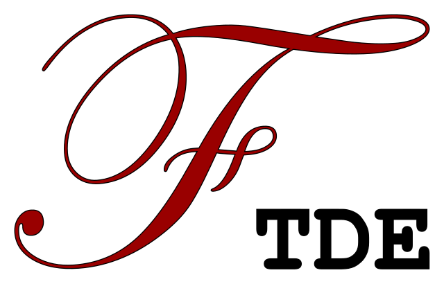

<p align="center"></p>

# Freya TDE

**Visuelle Entwicklungsumgebung für Rust im Stil von Delphi und Lazarus** – Formulare im Designer
zusammenstellen, Komponenten verdrahten, die Logik in Rust schreiben und das Ergebnis für das UI-Toolkit der
Wahl erzeugen: GTK 4, egui, iced, Slint, Flutter, eine WebView oder freya¹.

**A visual development environment for Rust in the style of Delphi and Lazarus** – put forms together in the
designer, wire up components, write the logic in Rust and generate the result for the UI toolkit of your
choice: GTK 4, egui, iced, Slint, Flutter, a web view or freya¹.

¹ [freya](https://freyaui.dev) (Marc Espín) ist ein eigenständiges Projekt und hat nichts mit Freya TDE zu tun;
Freya TDE unterstützt es nur als UI-Backend. / freya is an independent project and has nothing to do with
Freya TDE, which only supports it as a UI backend.

> **Mit Claude Code gebaut / Built with Claude Code**
>
> Freya TDE, das UI-Framework RUF und der CT-Editor wurden vollständig mit
> [Claude Code](https://claude.com/claude-code) (Modell Claude Opus 5.5) umgesetzt – Code, Tests, Packs,
> Symbole und Dokumentation.
>
> Freya TDE, the UI framework RUF and the CT-Editor were built entirely with
> [Claude Code](https://claude.com/claude-code) (model Claude Opus 5.5) – code, tests, packs, icons and
> documentation.

## Was steckt drin? / What's inside?

| | Deutsch | English |
|---|---|---|
| **Freya TDE** (`ide/`, `core/`, `designer/`) | die IDE: Designer, Objektinspektor, Code-Editor mit rust-analyzer, Debugger (DAP), Git wie in VS Code, Terminal, Schema-Browser | the IDE: designer, object inspector, code editor with rust-analyzer, debugger (DAP), Git like in VS Code, terminal, schema browser |
| **UI-Backends / UI backends** (`widgets/`) | GTK 4, egui, iced, Slint, Flutter, WebView, freya¹ – jedes mit eigener Palette | GTK 4, egui, iced, Slint, Flutter, WebView, freya¹ – each with its own palette |
| **Komponenten-Packs / component packs** (`components/`) | Tokio, SQLx (PostgreSQL, MySQL, SQLite), Redis/Valkey, Axum, WebSocket, HTTP | Tokio, SQLx (PostgreSQL, MySQL, SQLite), Redis/Valkey, Axum, WebSocket, HTTP |
| **[RUF](https://github.com/Freya-TDE/RUF)** (Submodul `RUF/`) | das UI-Framework der IDE auf GTK 4 | the IDE's UI framework on GTK 4 |
| **[CT-Editor](https://github.com/Freya-TDE/CT-E)** (Submodul `CT-Editor/`) | visueller Editor für `Cargo.toml` | visual editor for `Cargo.toml` |

## Schnellstart / Quick start

```bash
git clone --recurse-submodules https://github.com/Freya-TDE/Freya-TDE.git
cd Freya-TDE
cargo run --release -p freya-tde
```

Voraussetzungen: Rust ≥ 1.99, GTK 4 und GtkSourceView 5 mit Entwicklungsdateien; empfohlen rust-analyzer und
lldb-dap. / Requirements: Rust ≥ 1.99, GTK 4 and GtkSourceView 5 with development files; rust-analyzer and
lldb-dap recommended. Details: [Installieren](docs/de/02-installation.md) · [Installing](docs/en/02-installation.md).

## Handbuch / Handbook

Wie ein Buch aufgebaut – Überblick, Freya TDE, RUF, CT-Editor und bekannte Probleme.
Laid out like a book – overview, Freya TDE, RUF, CT-Editor and known problems.

- 🇩🇪 [Handbuch (Deutsch)](docs/de/README.md)
- 🇬🇧 [Handbook (English)](docs/en/README.md)

## Lizenz / License

Nach Wahl lizenziert unter / Licensed under either of

- Apache License, Version 2.0 ([LICENSE-APACHE](LICENSE-APACHE))
- MIT License ([LICENSE-MIT](LICENSE-MIT))

Code, den Freya TDE für Ihr Projekt erzeugt, gehört Ihnen. Beiträge werden, sofern nicht ausdrücklich anders
angegeben, unter denselben beiden Lizenzen eingebracht.
Code that Freya TDE generates for your project belongs to you. Unless explicitly stated otherwise,
contributions are dual-licensed as above.

© Dragon Software
