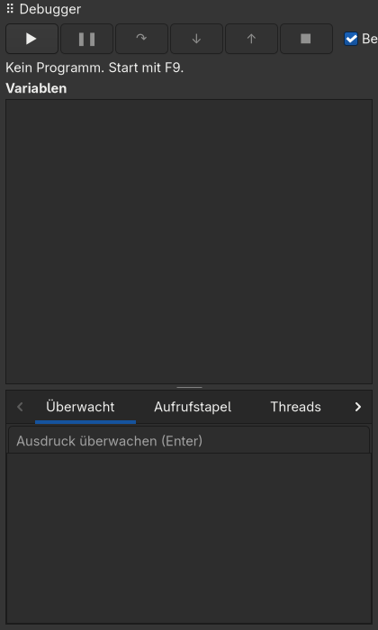
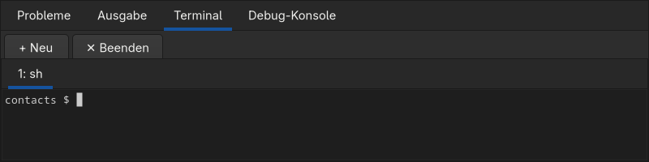

# 10 Bauen, Starten, Debuggen

[Inhalt](README.md) · zurück: [9 Erzeugter und eigener Code](09-code.md) · weiter: [11 Git](11-git.md)

## Bauen

**Projekt → Bauen** (Strg+F9) erzeugt den Code und ruft `cargo build` im Hintergrund auf. Die Meldungen von
Cargo landen unter **Meldungen → Probleme** und als Marken im Code; Meldungen in erzeugten `.gen.rs` werden
über eine Zuordnung der Komponente im Designer zugewiesen, die sie verursacht hat.

## Starten und Debuggen

Das Menü **Start** hat die Kürzel von Delphi und Lazarus:

| Kürzel | Tut |
|---|---|
| F9 | bauen und im Debugger starten; angehalten: weiter |
| Umschalt+Strg+F9 | ohne Debugger starten |
| Strg+F2 | Programm beenden |
| F7 / F8 / Umschalt+F8 | einzelne Anweisung / gesamte Routine / bis Rückgabe |
| F4 | bis Cursor (startet bei Bedarf) |
| F5 | Haltepunkt umschalten |
| Strg+F5 | Ausdruck überwachen |

Der Debugger spricht das Debug Adapter Protocol mit `lldb-dap` oder, falls der fehlt, `gdb -i dap` (ab gdb 14).
Er kann bedingte Haltepunkte, Trefferzahlen, Logpoints, „bei Panic anhalten“, Aufrufstapel, Threads,
Variablen und überwachte Ausdrücke. Ein Klick in die linke Randspalte des Code-Editors setzt einen Haltepunkt,
ein Rechtsklick bietet Bedingung, Trefferzahl, Logpoint und „Bis hier ausführen“. In der **Debug-Konsole**
wird Eingabe als Ausdruck ausgewertet, mit `` ` `` am Anfang geht sie als Befehl an den Debugger. Haltepunkte
und Ausdrücke sind persönlich (`<config>/freya-tde/debug.toml`). Ohne Debug-Adapter startet F9 das Programm
ohne Debugger und meldet das.

Flutter-Projekte starten immer ohne Debugger.

## Werkzeugleiste

Check, Clippy, Format, Test, Update, Doku und SQLx – siehe [Kapitel 4](04-fenster.md#die-werkzeugleiste).

## Terminal

**Meldungen → Terminal** (Strg+Umschalt+T) ist ein echtes Terminal mit der Shell des Nutzers im
Projektordner: Farben, Vollbildprogramme (`less`, `htop`, `vim`), tote Tasten und Eingabemethoden,
Mausauswahl, mehrere Terminals in Reitern.
