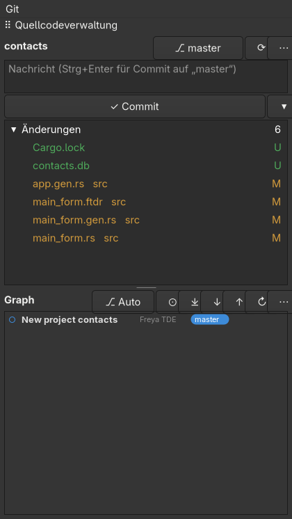

# 11 Git

[Inhalt](README.md) · zurück: [10 Bauen, Starten, Debuggen](10-bauen.md) · weiter: [12 Einstellungen](12-einstellungen.md)

Die Quellcodeverwaltung folgt VS Code und arbeitet über die `git`-Kommandozeile – mit Ihren Zugangsdaten,
SSH-Schlüsseln, Hooks und Einstellungen.

## Das Fenster „Quellcodeverwaltung“ (Strg+Umschalt+G)

- **Repository-Zeile:** Zweig (`main+` bei gestagten Änderungen; Klick = Zweig oder Tag auschecken), Sync
  (↓/↑ zum Upstream) und „…“ mit Pull, Push, Klonen, Fetch, Zweig-, Remote-, Stash- und Tag-Befehlen.
- **Commit-Nachricht** (Strg+Enter) mit Commit, Commit (Amend), Commit & Push, Commit & Sync und
  **Commit & Create Pull Request** (über die GitHub-CLI `gh`).
- **Gestaged** und **Änderungen** mit Statusbuchstaben (A, M, D, R, U, C = Konflikt), als Liste oder Baum:
  stagen, unstagen, verwerfen, Doppelklick zeigt den Diff.
- **Graph** mit Zweigen und „ausgehend“.

Außerdem: Markierungen im Projektbaum, der Zweig in der Statuszeile und Änderungsmarken am Rand des
Code-Editors (grün neu, blau geändert, rotes Dreieck gelöscht – verglichen mit dem gestagten Stand).

## Passwörter und Passphrasen

Fragt `git` oder `ssh` nach Passwort oder Passphrase, erscheint die Frage als Dialog im laufenden Freya TDE;
gespeichert wird nichts. Signierte Commits (GPG) fragt `gpg-agent` mit seinem eigenen Dialog ab.

## Projekte mit Unterprojekten

Im **Projekt-Manager** (Projektfenster) gibt es ein Hauptprojekt mit Unterprojekten. Unterprojekte im selben
Repository laufen bei den Git-Aktionen des Hauptprojekts mit; eines mit eigenem Repository wird bedient,
wenn es aktiv ist. Geteilte Angaben (Remote, Hauptzweig) stehen in der `.ptdr`, persönliche (Autor, E-Mail,
Signierschlüssel) in der lokalen `.git/config`.

**Neues Repository:** „Repository anlegen“ schreibt wie `cargo init` eine `.gitignore` mit `/target`.
