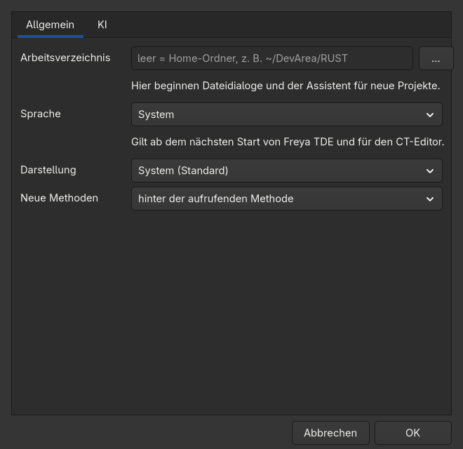

# 12 Einstellungen

[Inhalt](README.md) · zurück: [11 Git](11-git.md) · weiter: [13 Automatisierung und KI](13-automatisierung.md)

**Datei → Einstellungen …** (Strg+,) gilt für Freya TDE als Ganzes. Erst „OK“ übernimmt.

## Allgemein

| Einstellung | Wirkung |
|---|---|
| Arbeitsverzeichnis | Startordner der Dateidialoge und des Neu-Assistenten, z. B. `~/DevArea/RUST` (leer = Home-Ordner) |
| Sprache | System, Deutsch, English – für Freya TDE und den CT-Editor, gilt ab dem nächsten Start; „System“ heißt Deutsch bei deutscher Systemsprache, sonst Englisch |
| Darstellung | System (Standard), Hell, Dunkel – für Freya TDE und den CT-Editor |
| Neue Methoden | wohin die Code-Vervollständigung neue Methoden setzt: hinter die aufrufende, alphabetisch, ans Ende |

## KI

Mehrere **KI-Profile** mit Anbieter (Anthropic, OpenAI, Google Gemini, xAI, Mistral, DeepSeek, Groq,
OpenRouter, Ollama, LM Studio oder ein eigener OpenAI-kompatibler Server – lokal oder im Netzwerk), Modell,
Adresse und API-Key; ein Standardprofil und je Projekt ein eigenes („weil Projekt X so ist, nehme ich KI Y“).
**Abrufen** neben dem Modell fragt den Anbieter nach seinen Modellen – mit Adresse und Key, wie sie gerade im
Fenster stehen, also schon vor „OK“ – und füllt damit die Auswahl; das Modell lässt sich weiter frei eintippen.
Würde der API-Key über `http://` an einen anderen Rechner gehen, steht eine Warnung unter dem Key.
**Rechte der KI** gelten für das aktuelle Projekt: „nur lesen“, „mit Vorschau“ (Vorgabe) oder „selbstständig“
(dasselbe wie im KI-Fenster, siehe [Kapitel 13](13-automatisierung.md)).
Dazu „KI-Fenster bei neuem Projekt anzeigen“ und „immer anzeigen“.

**API-Keys** liegen im Schlüsselbund des Systems (Secret Service, macOS-Schlüsselbund,
Windows-Anmeldeinformationen); nur wenn keiner verfügbar ist, in der Einstellungsdatei. `FREYA_TDE_AI_KEY` gilt
für Profile ohne Key. Änderungen gehen erst mit „OK“ in den Schlüsselbund.

## Wo was gespeichert wird

Alles unter `<config>/freya-tde/` (Linux `~/.config/freya-tde`, macOS `~/Library/Application Support/freya-tde`,
Windows `%APPDATA%\freya-tde`):

| Datei | Inhalt |
|---|---|
| `settings.toml` | diese Einstellungen (nur für den Nutzer lesbar) |
| `desktop.toml` | Fensteranordnung, zusammengelegte Fenster |
| `projects.toml` | Projektliste (Haupt- und Unterprojekte) |
| `debug.toml` | Haltepunkte und überwachte Ausdrücke |
| `snippets.toml` | Code-Snippets |
