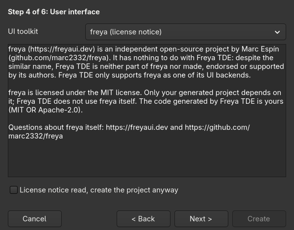
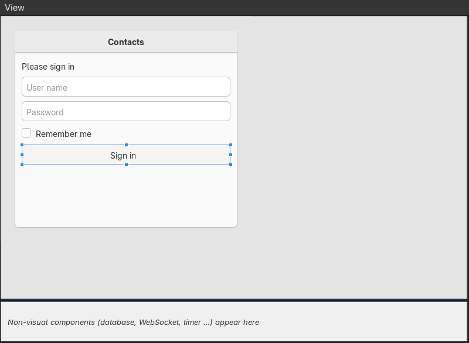
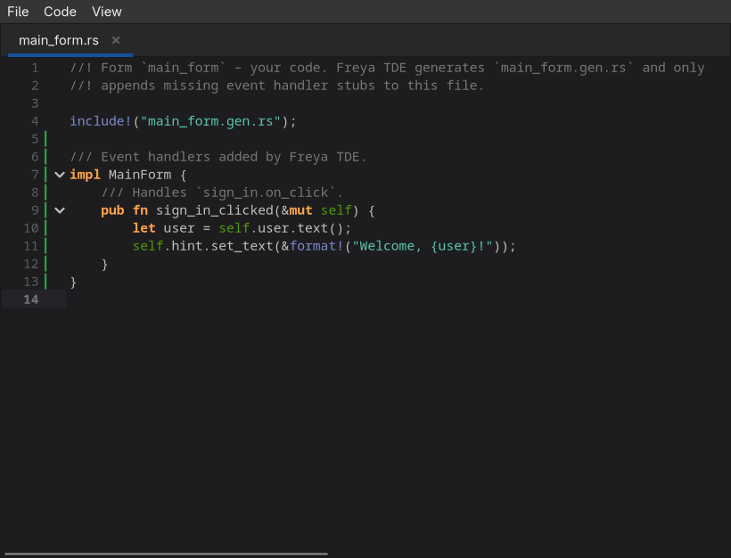

# 3 First steps

[Contents](README.md) · back: [2 Installing and building](02-installation.md) · next: [4 The windows](04-windows.md)

This chapter walks through once: new project, design a form, write an event, run.

## A new project



**File → New Project …** (Ctrl+N) opens the new-project wizard. Page by page:

1. **Kind:** program (with UI, `main.rs`) or library (data modules only, `lib.rs`).
2. **Name and location:** package name, parent folder (preset with the working directory from the settings),
   Rust version (preset with the installed one).
3. **Target systems:** Linux, Windows, macOS, Android, iOS, Web – your own is preselected.
4. **User interface:** the UI toolkit (GTK 4 is preselected). If a toolkit comes with license terms
   (Slint), the notice is shown here and has to be confirmed.
5. **Components** for the data module `services`: database (SQLx with driver and URL), Redis, web server
   (Axum, optionally with a WebSocket endpoint), WebSocket client, HTTP client, Tokio runtime. Tokio is added
   automatically when needed.
6. **Git and summary:** create a repository, make the first commit; below, all files that will be created
   and anything still missing.

"Create" saves the project, generates the code (it builds right away) and opens it.

## Designing the form



The new project has the form `main_form`.

- In the **palette** (main window), click a type and then click into the **designer** – or drag the palette
  button into the designer. The palette tabs: "Standard" (Label, Button, Edit, CheckBox, Container), the UI
  toolkit's palette (e.g. "GTK"), the component packs ("Database", "Web" …) and "Snippets".
- Set properties in the **object inspector**: the button's `caption`, colours, font, and in the "Placement"
  section size, percent or anchors.
- Non-visual components (database, timer, HTTP …) appear as an icon in the component bar at the bottom of the
  designer.

## Writing an event



Double-click the button: Freya TDE creates the handler, generates the code and jumps to it in the code
window – like Delphi:

```rust
impl MainForm {
    pub fn button1_on_click(&mut self) {
        // Your code. With the GTK backend every widget is a real gtk4 object:
        self.label1.set_text("Hello Freya!");
    }
}
```

The handler lives in `src/main_form.rs` – that file is yours. What Freya TDE generates is in
`src/main_form.gen.rs` and is rewritten on every run (see [chapter 9](09-code.md)).

## Building and running

- **F9** builds and starts the program in the debugger (without debugger: Shift+Ctrl+F9).
- Errors appear in the **Messages** window, tab "Problems", and as marks in the code;
  a click jumps there.
- The tool bar above the palette has Check, Clippy, Format, Test, Update, Doc and SQLx.

## Taking over an existing Cargo project

**File → Create Project from Cargo.toml …** creates a `.ptdr` for an existing Cargo project (or a
workspace with its members). Such projects are managed and built without Freya TDE generating code.
