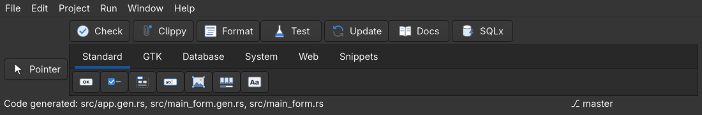
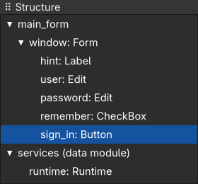
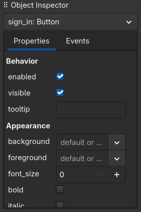
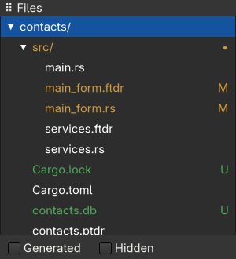
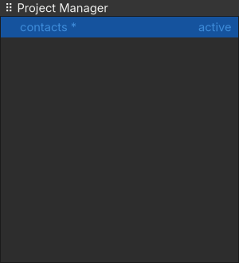
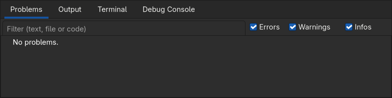
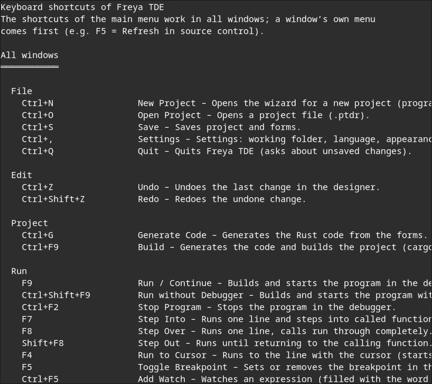

# 4 The windows

[Contents](README.md) · back: [3 First steps](03-first-steps.md) · next: [5 Forms and components](05-components.md)

Like Delphi 7 and Lazarus, Freya TDE consists of free-floating windows – each can go on any screen. The
arrangement is saved (`<config>/freya-tde/desktop.toml`) and restored on start; **Fenster → Standardanordnung**
(Window → default arrangement) resets it. The detailed operation of every window is described in
[`ide/README.md`](../../ide/README.md) (German).

| Window | In short |
|---|---|
| **Main window** | menu, tool bar (Check, Clippy, Format, Test, Update, Doc, SQLx), palette with one tab per category, tab "Snippets", status line with the Git branch |
| **Designer** | the form: select, place, drag, resize by handles, anchors; component bar at the bottom for non-visual components; F12 switches to the code |
| **Object inspector** | properties and events of the selected element, placement and layout |
| **Structure** | forms and elements as a tree |
| **Code** | one tab per file (GtkSourceView): highlighting, folding, error marks, Git change marks, breakpoints |
| **Messages** | tabs Problems, Output (build, program, Git, rust-analyzer, database), Terminal (several), Debug console |
| **Project** | tabs Files (project folder as a tree) and Project manager (main and subprojects) |
| **Source control** | Git like in VS Code (see [chapter 11](11-git.md)) |
| **Debugger** | variables, watches, call stack, threads, breakpoints |
| **Database** | schema browser for SQLx pools and Redis |
| **KI** (AI) | conversation with the AI: at the top the choice of AI (drop-down with all profiles, switchable at any time, remembered per project) and what it may do; history, proposals with preview (accept, reject, accept all), skills, input (Ctrl+Enter) – see [chapter 13](13-automation.md) |

### What the windows look like

   

## Combining structure, object inspector and AI

The three windows have a grip at the top ("⠿ Struktur", "⠿ Objektinspektor", "⠿ KI"). Drag one window's grip onto the
other window and both become **one window with tabs**. Drag the grip out into the open (next to every
window) and the tab becomes a window of its own again. This is kept in the window arrangement as well.

## The tool bar

| Button | Does |
|---|---|
| Check, Clippy | `cargo check` / `cargo clippy`; messages under "Problems" and as marks in the code |
| Format | `rustfmt` for each of your own files – generated `.gen.rs` files stay untouched |
| Test | `cargo test`, output in the "Build" channel |
| Update | shows what `cargo update` would change and asks |
| Doc | `cargo doc --no-deps`, opens the page in the browser |
| SQLx | `cargo sqlx prepare` (SQLx projects only, URL of the first pool) |

## Snippets

The **Snippets** tab at the far right of the palette holds saved pieces of code (name, short description,
use line, code):

- The **drop-down** lists them all; hovering shows the short description, choosing an entry inserts it at
  the cursor in the code. A non-empty use line is appended to the file's use block.
- **Right-click the drop-down:** edit, delete, put on the tab, new snippet.
- **Snippets put on the tab** are buttons: a click inserts, a right-click unpins or edits.
- **In the code editor:** select code → right-click → "Als Snippet speichern" (save as snippet).

## Keyboard shortcuts

**Hilfe → Tastenkürzel** (Help → keyboard shortcuts) lists every shortcut per window with an explanation. The
most important ones (like Delphi/Lazarus):

| Shortcut | Does |
|---|---|
| Ctrl+N / Ctrl+O / Ctrl+S | new project / open / save |
| Ctrl+, | settings |
| F12 | designer ↔ code |
| F11 | object inspector |
| Ctrl+G | generate code |
| Ctrl+F9 | build |
| F9 | run / continue (debugger) |
| F7 / F8 / Shift+F8 | step into / over / out |
| F4 / F5 | run to cursor / breakpoint |
| Ctrl+Space | complete |
| Ctrl+Shift+C | code completion (method, field, trait) |
| Ctrl+F12 / Ctrl+click | go to definition |
| Ctrl+Shift+G / B / M / U / T | source control / database / problems / output / terminal |
| Ctrl+Shift+K | AI |

The main menu's shortcuts work in every window; on macOS Ctrl is the Command key (⌘).
