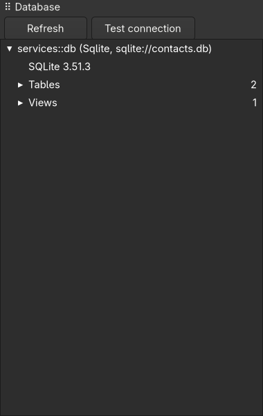

# 8 Databases and data binding

[Contents](README.md) · back: [7 Component packs](07-packs.md) · next: [9 Generated and own code](09-code.md)

The models are Delphi's `TQuery`, `TDBLookupComboBox` and `TDBGrid`: a data source delivers rows, lists and
grids show them – without writing the loading code yourself.

## Data sources

A data source is a type with a `[component.data]` section – such as the SQLx `Query` (SQL plus pool),
`redis/Read` or `http/Request`. Its property `columns` names the columns with their Rust type:

```text
id: i64
name: String
born: Option<chrono::NaiveDate>
```

The columns can be entered by hand or fetched straight from the database in the object inspector ("columns
aus Datenbank übernehmen").

## Binding lists and grids

Lists (DropDown, ListBox …) and the **DataGrid** get the properties `data_source`, `display_field` or
`fields`/`headers`, `value_field` and `load` (Start or Manual). The generator writes:

- `<list>_reload()` – loads in the background on Tokio, the form shows the rows when they arrive,
- `<list>_selected_value()` – the value of the selection, typed after `columns`,
- for the DataGrid a row struct `<Widget>Row` and `<grid>_selected_row()`.

## Editing in the DataGrid

With `editable`, cells can be changed, like a `TDataSet`:

- Rows are saved **per row** – when moving to another row or with Enter; **Esc** discards.
- New and deleted rows through `<grid>_insert()` and `<grid>_delete()` (for buttons of your own).
- Input is read after the column type; "two" in an `i64` column is refused. For `Option<…>` an empty cell
  is `None`.
- Events: `on_post(row, inserted) -> bool` (with `false` the row stays in editing, e.g. for a validation),
  `on_delete(row) -> bool`, `on_post_error(error)`.

**Automatic write-back:** If the SQLx `Query` also gets `table` and `key` (key columns), Freya TDE generates
`UPDATE`, `INSERT` and `DELETE` with bound parameters (`$1` for PostgreSQL, `?` for MySQL and SQLite) and
writes in the background. With `generated_key` the `INSERT` leaves the key out (the database assigns it) and
the grid is loaded again. Without `table` there are only the events and you write yourself. Tested against
SQLite, PostgreSQL and MariaDB.

How each backend presents editing is listed in [chapter 16](16-problems.md#limits-of-the-ui-backends).

## The schema browser



**Fenster → Datenbank** (Window → database, Ctrl+Shift+B) shows, per SQLx pool, the tables, views, columns
(with SQL and Rust type, primary key), functions and procedures, and per Redis client the keys. The object
inspector offers "Verbindung testen" (test connection, for pool and query) and "columns aus Datenbank
übernehmen" (take over columns from the database).

Behind it is the helper `freya-tde-db` ([`db/README.md`](../../db/README.md)): a separate process Freya TDE
talks to in JSON lines. It opens SQLite files read-only and never creates one; passwords in URLs are masked
in the display.
