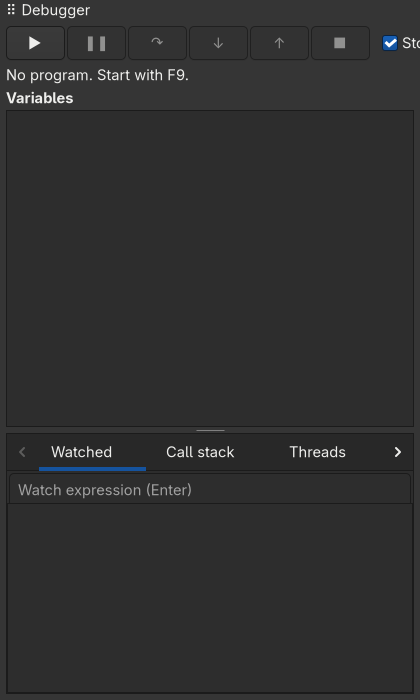
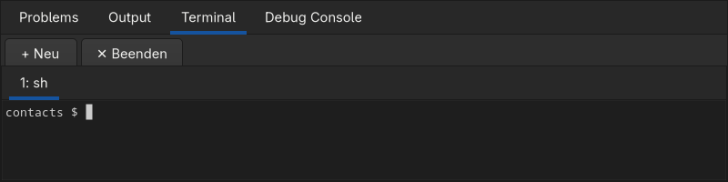

# 10 Building, running, debugging

[Contents](README.md) · back: [9 Generated and own code](09-code.md) · next: [11 Git](11-git.md)

## Building

**Projekt → Bauen** (Project → build, Ctrl+F9) generates the code and runs `cargo build` in the background.
Cargo's messages appear under **Messages → Problems** and as marks in the code; messages in generated
`.gen.rs` files are attributed to the component in the designer that caused them.

## Running and debugging

The **Start** menu has the shortcuts of Delphi and Lazarus:

| Shortcut | Does |
|---|---|
| F9 | build and start in the debugger; when paused: continue |
| Shift+Ctrl+F9 | start without debugger |
| Ctrl+F2 | end the program |
| F7 / F8 / Shift+F8 | step into / over / out |
| F4 | run to cursor (starts if needed) |
| F5 | toggle breakpoint |
| Ctrl+F5 | watch expression |

The debugger speaks the Debug Adapter Protocol with `lldb-dap` or, if that is missing, `gdb -i dap`
(gdb 14 or later). It supports conditional breakpoints, hit counts, logpoints, "stop on panic", call stack,
threads, variables and watches. A click into the left gutter of the code editor sets a breakpoint; a
right-click offers condition, hit count, logpoint and "run to here". In the **debug console**, input is
evaluated as an expression; with a leading `` ` `` it goes to the debugger as a command. Breakpoints and
watches are personal (`<config>/freya-tde/debug.toml`). Without a debug adapter, F9 starts the program
without debugger and says so.

Flutter projects always start without debugger.

## Tool bar

Check, Clippy, Format, Test, Update, Doc and SQLx – see [chapter 4](04-windows.md#the-tool-bar).

## Terminal

**Messages → Terminal** (Ctrl+Shift+T) is a real terminal with the user's shell in the project folder:
colours, full-screen programs (`less`, `htop`, `vim`), dead keys and input methods, mouse selection, several
terminals in tabs.
