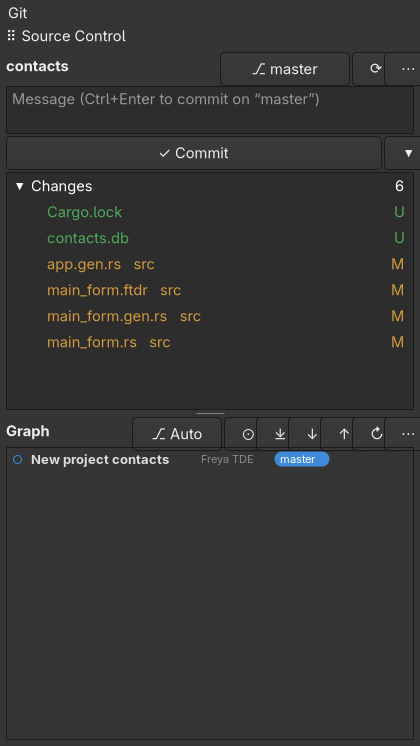

# 11 Git

[Contents](README.md) · back: [10 Building, running, debugging](10-building.md) · next: [12 Settings](12-settings.md)

Source control follows VS Code and works through the `git` command line – with your credentials, SSH keys,
hooks and settings.

## The window "Source Control" (Ctrl+Shift+G)

- **Repository line:** branch (`main+` with staged changes; click = check out a branch or tag), sync (↓/↑ to
  the upstream) and "…" with pull, push, clone, fetch, branch, remote, stash and tag commands.
- **Commit message** (Ctrl+Enter) with Commit, Commit (Amend), Commit & Push, Commit & Sync and
  **Commit & Create Pull Request** (through the GitHub CLI `gh`).
- **Staged** and **Changes** with status letters (A, M, D, R, U, C = conflict), as a list or tree: stage,
  unstage, discard, double-click shows the diff.
- **Graph** with branches and "outgoing".

Also: marks in the project tree, the branch in the status line and change marks in the gutter of the code
editor (green new, blue changed, red triangle deleted – compared with the staged state).

## Passwords and passphrases

If `git` or `ssh` asks for a password or passphrase, the question appears as a dialog in the running Freya
TDE; nothing is stored. Signed commits (GPG) are handled by `gpg-agent` with its own dialog.

## Projects with subprojects

The **project manager** (project window) has a main project with subprojects. Subprojects in the same
repository take part in the main project's Git actions; one with its own repository is served while it is
active. Shared details (remote, main branch) are in the `.ptdr`, personal ones (author, e-mail, signing key)
in the local `.git/config`.

**New repository:** "Create Repository" writes a `.gitignore` with `/target`, like
`cargo init`.
